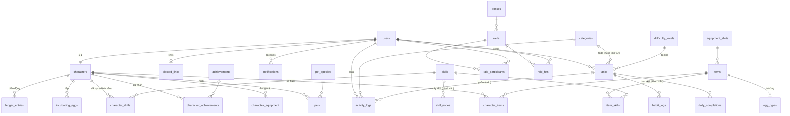

# Thiết kế database QuestLife (PostgreSQL)

Tài liệu này là **bản đề xuất để bạn duyệt**, chưa phải code đang chạy. Mục 5 nói rõ chỗ nào khác với code hiện tại, mục 6 là các điểm mình cần bạn quyết.

## 0. Trạng thái: đã chốt và đã triển khai

Các quyết định của bạn: chuẩn hóa nhân vật, danh mục nằm trong DB, `tasks` một bảng, có `ledger_entries`, làm luôn bảng skill, múi giờ mặc định UTC+7 nhưng cho người nước khác dùng, phần thưởng boss tùy chỉnh được (vàng, đồ, pet, danh hiệu), mana hồi đầy mỗi ngày.

**Đã triển khai** (migration `InitialSchema`, 34 bảng, danh mục được nạp sẵn bằng migration):

| Nhóm | Bảng |
|---|---|
| Tài khoản | `users` (thêm `time_zone`, `last_login_at`) |
| Danh mục | `categories`, `difficulty_levels`, `shop_categories`, `equipment_slots`, `item_subtypes`, `items`, `egg_types`, `pet_species`, `titles`, `achievements`, `bosses`, `boss_rewards` |
| Skill | `skills`, `item_skills`, `skill_nodes`, `character_skills` (chỉ có bảng, chưa có gameplay) |
| Nhân vật | `characters`, `character_items`, `character_equipment`, `pets`, `incubating_eggs`, `character_titles`, `character_achievements`, `ledger_entries`, `notifications` |
| Task | `tasks`, `daily_completions`, `habit_logs`, `activity_logs` |
| Raid | `raids`, `raid_participants`, `raid_hits`, `raid_reward_claims` |

**Khác với bản đề xuất ở trên:**

- Phần thưởng boss là bảng `boss_rewards` (mỗi dòng một phần thưởng, `kind` = Gold / Item / Pet / Title) và `raid_reward_claims`, thay cho `raid_rewards` + `raid_reward_claims` trong đề xuất. Thêm bảng `titles` riêng (danh hiệu có thể đến từ thành tựu hoặc từ boss) và `shop_categories`.
- Khóa `row_version` không dùng: mọi thay đổi nhân vật đều chạy trong một transaction có `SELECT ... FOR UPDATE` trên dòng `characters`, và dòng `raids` cũng bị khóa khi gây sát thương.
- `daily_completions` thay cho cột `last_completed_period`; bộ đếm `+/−` của habit tính từ `habit_logs`; `tasks.overdue_penalized` đổi thành `overdue_penalized_at`.
- `characters.mana_refreshed_on` (ngày theo múi giờ người chơi): sang ngày mới thì mana hồi đầy.
- `discord_links` chưa tạo, sẽ thêm khi làm tích hợp Discord.
- `users.time_zone` lưu id IANA. Việc định kỳ, hạn chót, chuỗi ngày và hồi mana theo múi giờ của từng người. Bảng xếp hạng tuần và raid dùng chung một mốc cố định (thứ Hai 00:00 giờ Việt Nam, đổi được bằng `GameTimeZoneOffsetHours`) để mọi người chạy cùng một cuộc đua.
- Danh mục được nạp vào DB bằng migration, app đọc lại từ DB mỗi 10 phút nên sửa trực tiếp trong DB là có hiệu lực mà không cần deploy.

**Bổ sung sau đó — dữ liệu cứng trong code đã chuyển vào DB** (migration `ConfigurableGameData`):

| Bảng | Nội dung | Thay cho |
|---|---|---|
| `level_titles` | Tên bậc theo cấp (Novice, Apprentice, ...). Thêm một dòng là có bậc mới. Cột `title_id` (tùy chọn) tự cấp một danh hiệu chọn được khi đạt cấp đó | hàm `TitleOf` trong `Gamification.cs` |
| `badges` | Huy hiệu trên Dashboard (chỉ số `metric` + `target`) | danh sách huy hiệu trong code |
| `rarities` | Tên độ hiếm (Common, Rare, Epic, Legendary) | `RarityInfo` |
| `equipment_slots.emoji` | Biểu tượng của từng ô trang bị | `SlotInfo` |
| `time_zones` | Danh sách múi giờ hiện trong form | `TimeZones.cs` |
| `game_settings` | 33 con số cân bằng: đường cong cấp (`level_exp_base`, `level_exp_exponent`), thưởng chuỗi, LUK/ATK/DEF, chỉ số gốc theo cấp, giá và giới hạn của pet, vàng khởi đầu... | các hằng số trong `Gamification`, `Rewards`, `PetLogic`, `CharacterService` |

App đọc lại các bảng này mỗi 10 phút (và khi khởi động), nên sửa trực tiếp trong DB là có hiệu lực mà không cần deploy.

---

## 1. Nguyên tắc chung

- PK là `uuid` cho dữ liệu người dùng tạo ra; bảng log lớn dùng `bigint identity`; bảng danh mục (catalog) dùng khóa tự nhiên dạng `text` (ví dụ `sword_iron`) để dễ đọc.
- Giờ lưu `timestamptz` (UTC). Ngày nghiệp vụ (deadline, kỳ của daily) lưu `date`, tính theo giờ UTC+7 như hiện tại.
- Tiền, EXP, HP là số nguyên. Số giờ/lần (effort, amount) là `numeric(6,2)`.
- Enum đơn giản (type, priority, repeat) dùng `text` + `CHECK`. Thứ có thuộc tính riêng (lĩnh vực, ô trang bị, độ khó) dùng bảng tra cứu.
- Số dư vàng/EXP/HP nằm trên `characters` (để đọc nhanh), mọi thay đổi đều ghi vào `ledger_entries` (để kiểm tra, sửa lỗi, hiển thị lịch sử).
- Chạy nhiều instance web trên AWS thì **không thể dùng lock trong bộ nhớ như hiện tại**: mọi thao tác đổi trạng thái nhân vật phải `SELECT ... FOR UPDATE` dòng `characters` trong một transaction.

## 2. Sơ đồ quan hệ (rút gọn)



## 3. Chi tiết bảng

### 3.1 Tài khoản
**`users`** (đã có)

| Cột | Kiểu | Ghi chú |
|---|---|---|
| id | uuid PK | |
| username | varchar(50) | unique, lưu chữ thường |
| email | varchar(256) | unique, lưu chữ thường |
| password_hash | text | |
| created_at | timestamptz | |
| last_login_at | timestamptz null | mới, tùy chọn |

**`discord_links`** (cho tích hợp Discord sau này)

| Cột | Kiểu | Ghi chú |
|---|---|---|
| user_id | uuid PK, FK users | 1 user - 1 tài khoản Discord |
| discord_user_id | text | unique |
| channel_id | text null | kênh nhận thông báo riêng, nếu có |
| notify_flags | int | bitmask: nhắc deadline, bị trừ máu, hạ boss... |
| linked_at | timestamptz | |

### 3.2 Danh mục (dữ liệu tham chiếu, seed bằng migration)

| Bảng | Cột chính | Thay cho |
|---|---|---|
| **`categories`** | id smallint PK, slug, name, board_name, emoji, unit, is_hours, max_per_entry | `Categories` trong code (5 lĩnh vực BXH) |
| **`difficulty_levels`** | level 1..5 PK, name, base_gold, base_exp, base_damage, base_hp_loss | mảng trong `Rewards.cs`, giờ chỉnh cân bằng không cần deploy |
| **`equipment_slots`** | id smallint PK, code (weapon, helmet, armor, boots, ring, amulet, egg), name, shop_category (weapon/armor/jewelry/pet), is_equippable | `ItemSlot` + `ShopCategory` |
| **`item_subtypes`** | id, slot_id FK, name (Kiếm, Cung, Gậy phép, Rìu & Búa, Mũ, Giáp, Áo choàng...) | chuỗi `SubType` |
| **`items`** | id text PK, name, slot_id FK, subtype_id FK, rarity, price, emoji, description, **atk, def, int_, luk, max_hp, max_mana** (mỗi cột int default 0), is_active | `ItemCatalog` (hiện chỉ có `Power`, chỉ số suy ra bằng công thức) |
| **`egg_types`** | item_id PK FK items, hatch_minutes, base_rarity | `PetCatalog.Eggs` |
| **`pet_species`** | id text PK, name, emoji, rarity | `PetCatalog.Species` |
| **`achievements`** | id text PK, name, icon, description, reward_gold, metric (mã chỉ số: `streak`, `study_hours`, `pets_owned`...), target bigint | `AchievementCatalog` (điều kiện vẫn tính trong code theo `metric`) |
| **`bosses`** | id smallint PK, name, emoji, title, lore, max_hp | `BossCatalog` |

`rarity` là `text` có `CHECK IN ('common','rare','epic','legendary')`.

### 3.3 Nhân vật (thay cho cục JSON `PlayerData`)

**`characters`** (1-1 với users)

| Cột | Kiểu | Ghi chú |
|---|---|---|
| user_id | uuid PK, FK users | |
| exp | int | cấp tính từ exp trong code (hoặc cột sinh) |
| gold | int | `CHECK (gold >= 0)` |
| hp, mana | int | |
| deaths | int | |
| tasks_completed | int | |
| coop_level, incubator_level | smallint | |
| companion_pet_id | uuid null FK pets | |
| active_title_id | text null FK achievements | |
| skill_points | int default 0 | dành sẵn cho skill tree |
| updated_at | timestamptz | |
| row_version | int | khóa lạc quan, tăng mỗi lần ghi |

**`character_items`**: túi đồ + đồ đang mặc, `(user_id, item_id)` PK, `quantity int CHECK (quantity > 0)`.
Trang bị là duy nhất (quantity = 1), trứng cộng dồn.

**`character_equipment`**: ô đang mặc.

```sql
CREATE TABLE character_equipment (
  user_id uuid NOT NULL,
  slot_id smallint NOT NULL,
  item_id text NOT NULL,
  PRIMARY KEY (user_id, slot_id),
  FOREIGN KEY (user_id, item_id) REFERENCES character_items (user_id, item_id),
  FOREIGN KEY (item_id, slot_id) REFERENCES items (id, slot_id)   -- items có UNIQUE (id, slot_id)
);
```
Hai khóa ngoại này bảo đảm: chỉ mặc món mình sở hữu, và món đó đúng loại ô. Túi đồ hiển thị = `character_items` trừ đồ đang mặc.

**`pets`**: id uuid PK, user_id, species_id, name, level, xp, adopted_at.
**`incubating_eggs`**: id uuid PK, user_id, egg_item_id, started_at, ready_at.
**`character_achievements`**: `(user_id, achievement_id)` PK, claimed_at.

**Dành sẵn cho skill (Mana)** — chưa cần tạo ở giai đoạn đầu:

| Bảng | Cột chính |
|---|---|
| `skills` | id text PK, name, description, mana_cost, cooldown_seconds, effect jsonb |
| `item_skills` | item_id, skill_id (trang bị ban skill) |
| `skill_nodes` | id, skill_id, parent_node_id null, required_level, point_cost (cây skill) |
| `character_skills` | user_id, skill_id, level, unlocked_at, source (item / tree) |

### 3.4 Task

**`tasks`**: một bảng cho cả 3 loại, ràng buộc bằng `CHECK`.

```sql
CREATE TABLE tasks (
  id uuid PRIMARY KEY DEFAULT gen_random_uuid(),
  user_id uuid NOT NULL REFERENCES users(id) ON DELETE CASCADE,
  type text NOT NULL CHECK (type IN ('habit','daily','todo')),
  title varchar(200) NOT NULL,
  description varchar(2000),
  difficulty smallint NOT NULL REFERENCES difficulty_levels(level),
  priority smallint NOT NULL CHECK (priority BETWEEN 1 AND 3),      -- 1 thấp .. 3 cao
  created_at timestamptz NOT NULL DEFAULT now(),
  archived_at timestamptz,                                           -- xóa mềm
  -- todo
  deadline date,
  category_id smallint REFERENCES categories(id),
  effort numeric(6,2) CHECK (effort > 0),
  completed_at timestamptz,
  overdue_penalized_at timestamptz,
  -- daily
  repeat text CHECK (repeat IN ('daily','weekly','monthly','yearly')),
  last_checked_period date,
  streak int NOT NULL DEFAULT 0,
  best_streak int NOT NULL DEFAULT 0,
  CONSTRAINT todo_only  CHECK (type = 'todo'  OR (deadline IS NULL AND category_id IS NULL AND effort IS NULL AND completed_at IS NULL)),
  CONSTRAINT daily_only CHECK ((type = 'daily') = (repeat IS NOT NULL)),
  CONSTRAINT effort_with_category CHECK ((category_id IS NULL) = (effort IS NULL))
);
```

**`daily_completions`**: `(task_id, period_start)` PK, completed_at. Một dòng cho mỗi kỳ đã hoàn thành. Dùng để vẽ lịch/heatmap và tính kỳ bị bỏ lỡ chính xác.
**`habit_logs`**: id bigint, task_id, direction (`+`/`-`), created_at. Bộ đếm +/− tính từ đây, cho phép hoàn tác và vẽ biểu đồ.

### 3.5 Hoạt động & bảng xếp hạng

**`activity_logs`**: id uuid PK, user_id, category_id, amount numeric(6,2), note, **source_task_id uuid null (ON DELETE SET NULL)**, logged_at.
Index: `(category_id, logged_at DESC) INCLUDE (user_id, amount)` cho BXH, `(user_id, logged_at DESC)` cho streak và nhật ký.
BXH vẫn là truy vấn `SUM ... GROUP BY user_id`. Khi đông người thì thêm materialized view theo tuần, chưa cần ngay.

### 3.6 Raid boss

| Bảng | Cột chính |
|---|---|
| **`raids`** | id uuid PK, boss_id FK, starts_at, ends_at, max_hp (chụp lại lúc tạo), damage_dealt (cache), status (`active`/`defeated`/`expired`), defeated_at. `UNIQUE (starts_at)` |
| **`raid_participants`** | `(raid_id, user_id)` PK, joined_at (thay cho `JoinedRaidWeek`) |
| **`raid_hits`** | id bigint PK, raid_id, user_id, damage int, task_id null, dealt_at. Index `(raid_id, user_id)` |

Khi gây sát thương: khóa dòng `raids`, kiểm tra `damage_dealt`, cắt sát thương theo máu còn lại, cập nhật `damage_dealt`, đổi `status` nếu hạ gục. Phần thưởng hạ boss (chưa quyết) sẽ thêm `raid_rewards` + `raid_reward_claims` sau.

### 3.7 Sổ cái và thông báo

**`ledger_entries`**: id bigint PK, user_id, kind (`task_reward`, `habit_fail`, `miss_penalty`, `death`, `purchase`, `pet_feed`, `upgrade`, `achievement_reward`...), gold_delta, exp_delta, hp_delta, task_id null, item_id null, note, created_at.
Có thể kiểm tra `characters.gold = SUM(gold_delta)` bất cứ lúc nào, và giải thích được vì sao nhân vật mất máu hoặc chết.

**`notifications`**: id bigint PK, user_id, kind, message, created_at, read_at null, discord_sent_at null. Thay cho `Notices` trong JSON, đồng thời là hàng đợi gửi Discord.

## 4. Ràng buộc và index đáng chú ý

- Unique: `users.username`, `users.email`, `discord_links.discord_user_id`, `raids.starts_at`.
- `tasks`: index `(user_id, type) WHERE archived_at IS NULL`; index `(deadline) WHERE type='todo' AND completed_at IS NULL` cho bộ quét phạt.
- `characters`: `CHECK (gold >= 0)`, `CHECK (hp >= 0)`.
- Khóa ngoại tới `users` đều `ON DELETE CASCADE`, trừ `activity_logs.source_task_id` là `SET NULL` (xóa task không làm mất lịch sử BXH).
- Task nên **xóa mềm** (`archived_at`) vì sổ cái và log đang tham chiếu tới nó.

## 5. So với code hiện tại

| Hiện tại | Đề xuất |
|---|---|
| Trạng thái nhân vật là **một cục JSON** (`players.data`, kiểu text) | Tách thành `characters`, `character_items`, `character_equipment`, `pets`, `incubating_eggs`, `character_achievements` |
| Danh mục (đồ, pet, danh hiệu, boss, bảng điểm) nằm **trong code** | Nằm trong DB, chỉnh cân bằng không cần deploy |
| Chỉ số đồ suy ra từ `Power` bằng công thức | Cột chỉ số tường minh trên `items` |
| Đồ đang mặc bị **chuyển ra khỏi túi** | `character_items` giữ tất cả, `character_equipment` chỉ trỏ tới món đang mặc |
| Boss tuần tính bằng phép toán theo ngày, không lưu | Bảng `raids` có lịch sử, máu chốt lúc tạo |
| Tham gia raid = số tuần trong JSON | `raid_participants` |
| Bộ đếm habit, `LastCompletedPeriod` của daily | `habit_logs`, `daily_completions` (vẫn giữ `last_checked_period`) |
| `Notices` trong JSON | `notifications` |
| Không có lịch sử vàng/EXP/HP | `ledger_entries` |
| Khóa chống bấm đúp bằng lock trong bộ nhớ | `SELECT ... FOR UPDATE` trên `characters` |
| Todo xóa là mất | Xóa mềm bằng `archived_at` |
| `XpPerUnit` của lĩnh vực | Bỏ: thưởng giờ chỉ dựa vào độ khó |

## 6. Điểm cần bạn quyết

1. **Chuẩn hóa hay giữ JSON cho nhân vật?** Mình khuyên chuẩn hóa vì cần truy vấn chéo người chơi (Discord, thống kê pet/đồ), kiểm tra toàn vẹn (không mặc đồ không có, không mặc sai ô) và chạy nhiều instance. JSON nhanh làm hơn và không cần migration khi thêm trường, nhưng khó truy vấn và dễ sai dữ liệu.
2. **Danh mục trong DB hay trong code?** Mình khuyên DB (seed bằng migration). Đổi lại thêm một màn quản trị hoặc script khi muốn chỉnh.
3. **`tasks` một bảng hay tách ba bảng con?** Mình khuyên một bảng + `CHECK` vì chỉ có khoảng 8 cột riêng và truy vấn dashboard đơn giản. Tách bảng chỉ đáng khi mỗi loại phình thêm nhiều cột.
4. **Có cần `ledger_entries` ngay không?** Mình khuyên có, vì nó rẻ và cứu bạn mỗi khi cần điều tra "vàng đi đâu".
5. **Bảng skill:** tạo luôn từ đầu hay đợi đến khi làm skill? Mình khuyên đợi, chỉ thêm `characters.skill_points` và chừa chỗ như mục 3.3.
6. **Múi giờ:** hiện cố định UTC+7. Nếu có người dùng ở nước khác thì cần `users.timezone` và đổi cách tính "ngày", việc này đáng quyết sớm vì ảnh hưởng đến cách tính kỳ của daily.
7. **Phần thưởng hạ boss:** chưa có thiết kế, mình để trống `raid_rewards`. Khi bạn chốt (vàng, đồ, pet, danh hiệu?) mình sẽ bổ sung.
8. **Mana:** mình giữ cột `mana` trên `characters`. Khi nào làm skill, bạn cho biết mana hồi theo cách nào (theo thời gian, theo task hoàn thành) để thêm cột `mana_updated_at` nếu hồi theo thời gian.

## 7. Lộ trình áp dụng nếu bạn đồng ý

1. **Giai đoạn 1 (giá trị cao, chi phí thấp):** `raids` + `raid_participants`, `ledger_entries`, `notifications`, `activity_logs.source_task_id`, xóa mềm cho `tasks`.
2. **Giai đoạn 2:** tách `characters` và các bảng con khỏi JSON; chuyển danh mục vào DB; thay lock bộ nhớ bằng `FOR UPDATE`.
3. **Giai đoạn 3:** `habit_logs`, `daily_completions`, `discord_links`.
4. **Sau cùng:** bảng skill và `raid_rewards` khi đã có thiết kế gameplay.

Mỗi giai đoạn đều có migration và script chuyển dữ liệu từ bản hiện tại.
